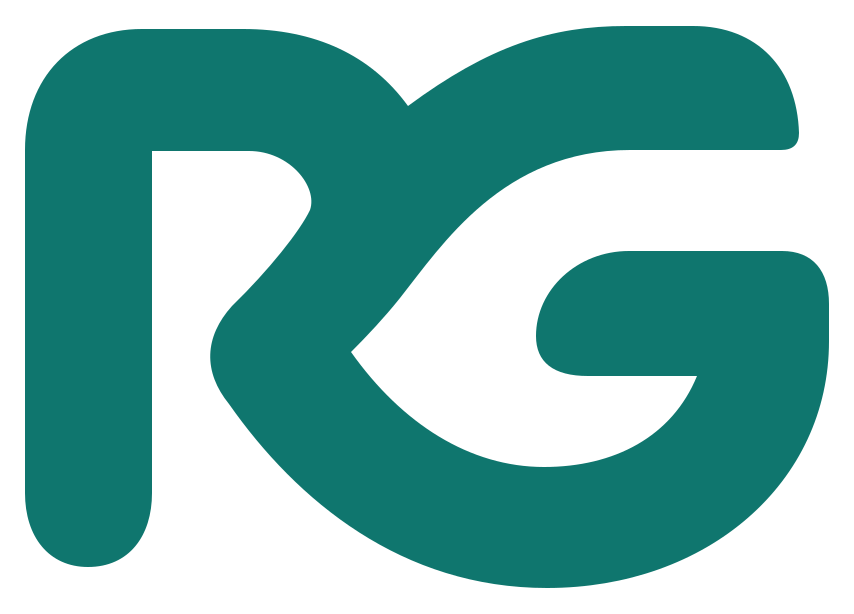
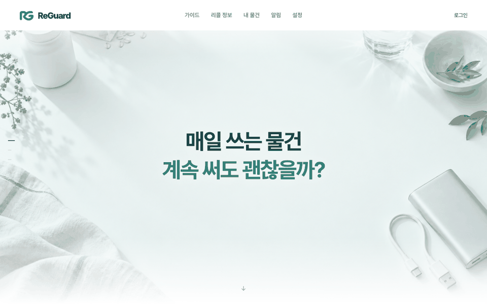
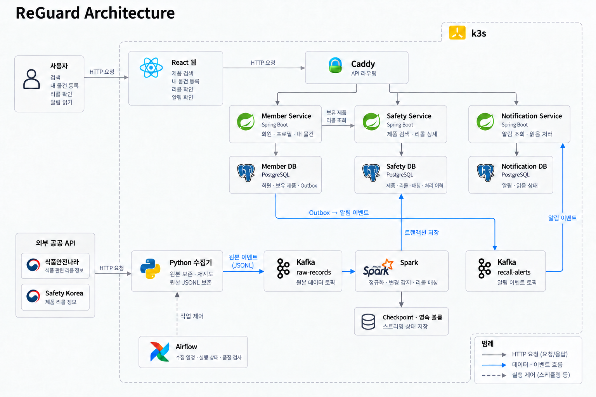
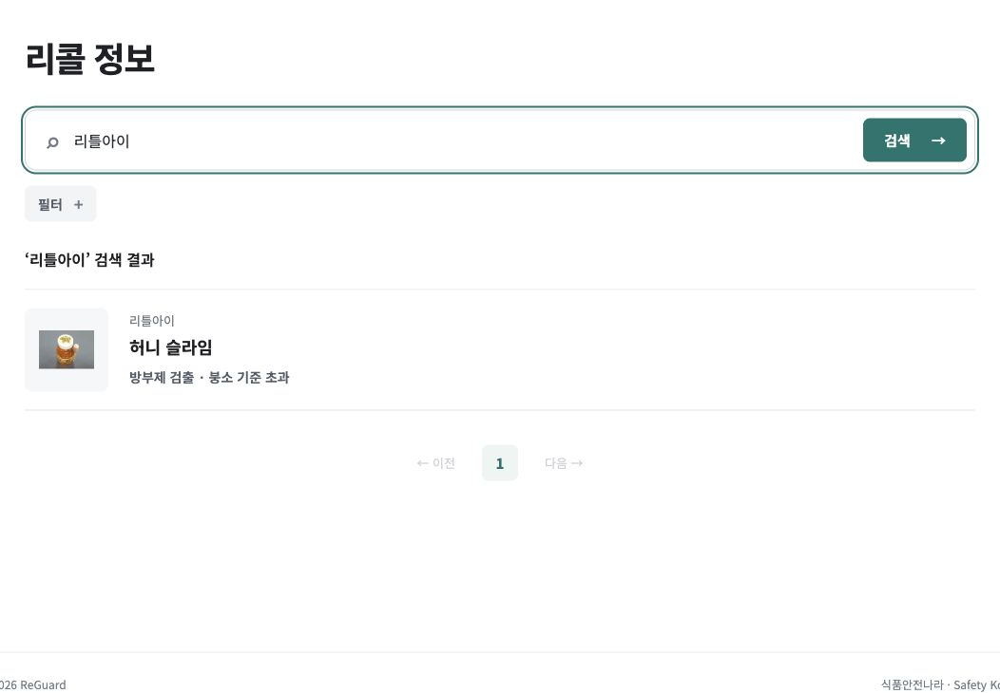
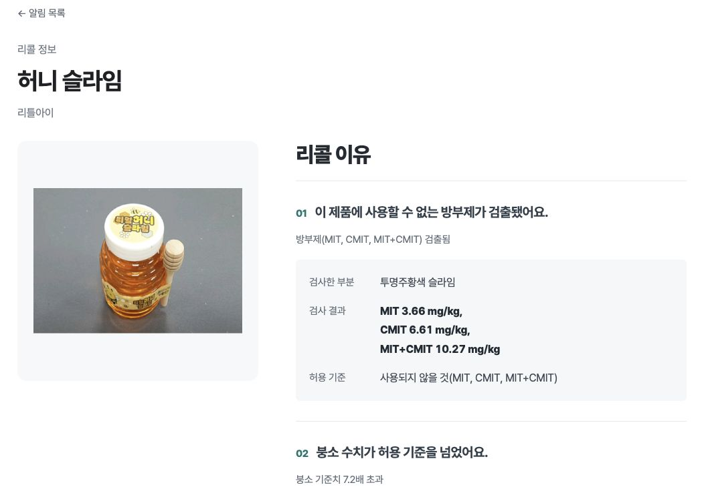
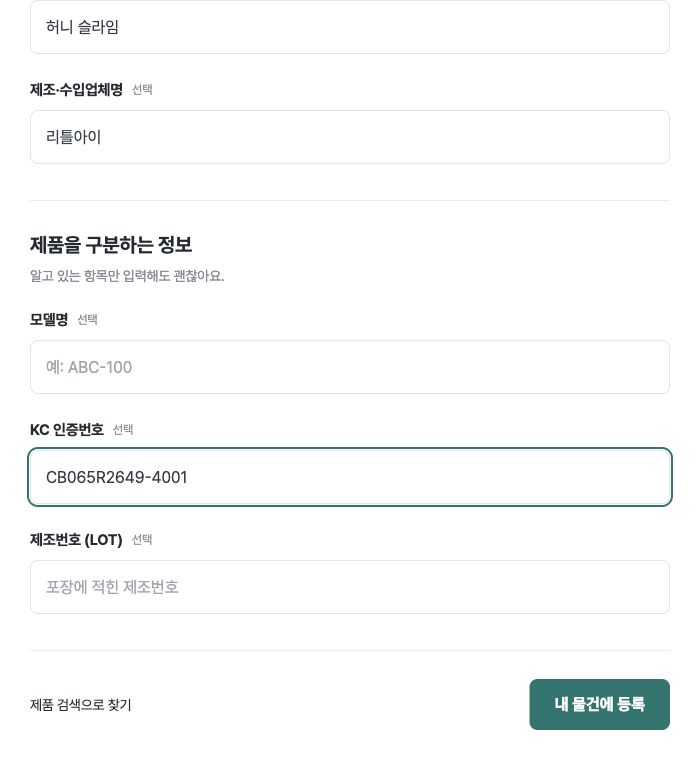
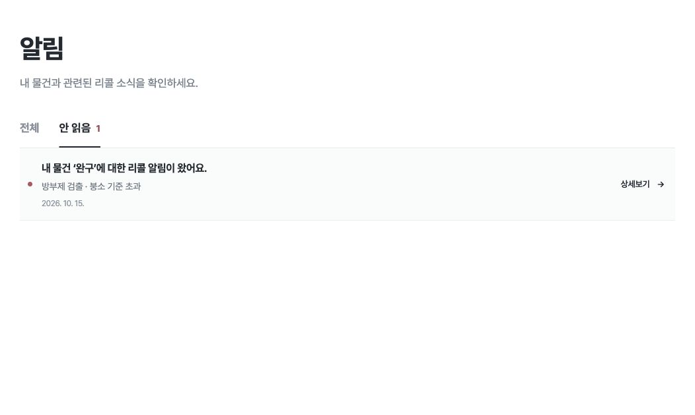

<p align="center">
  
</p>
<p align="center"><strong>매일 쓰는 물건 계속 써도 괜찮을까?</strong><br />내 물건과 관련된 리콜 정보를 한곳에서.</p>

<p align="center">
  
</p>

<p align="center">
  
  
  
  
  <br />
  
  
  
  
  
  
</p>

<p align="center">
  <a href="#overview">Overview</a> · <a href="#architecture">Architecture</a> · <a href="#demo">Demo</a> · <a href="#quick-start">Quick Start</a> · <a href="#verification">Verification</a>
</p>

<br />

## Overview

슬라임과 말랑이 등 촉감 완구에서 유해물질이 검출되는 사례가 있습니다. 2026년 9월 국가기술표준원 조사에서는 KC 인증을 받은 슬라임 2개 제품에도 리콜 명령이 내려졌습니다. 구매할 때 확인한 정보만으로는 이후의 리콜 소식까지 알기 어렵습니다. [관련 보도자료](https://www.korea.kr/briefing/pressReleaseView.do?newsId=156781874)

**리콜 소식을 봐도 내 물건이 대상인지 확인하는 과정은 남아 있습니다.**

| 사용자가 겪는 불편 | ReGuard의 해결 방식 |
|---|---|
| 식품과 생활 제품의 리콜 정보를 기관별로 찾아봐야 함 | 식품안전나라와 Safety Korea의 정보를 한곳에서 검색 |
| 제품명이 비슷해 내 물건이 대상인지 판단하기 어려움 | 제품 식별 정보와 리콜 사유, 제조일자 등 대상 조건 제공 |
| 구매한 물건의 새 리콜 공고를 계속 확인해야 함 | 등록한 물건과 관련된 리콜과 변경 소식을 알림으로 제공 |

ReGuard는 제품과 리콜 데이터를 통합해 내 물건과 관련된 리콜 소식을 확인하고 대상 조건을 비교할 수 있는 서비스입니다.

| 제품 검색과 등록 | 리콜 정보 확인 | 내 물건 알림 |
|:---:|:---:|:---:|
| 제품명이나 식별자로 검색하고 직접 등록 | 리콜 사유와 대상 조건 확인<br />조치 방법 안내 | 등록 물건의 관련 리콜과 변경 소식 확인 |
| 등록 정보 수정과 삭제 | 확정 매칭과 후보 구분 | 읽음 처리와 미확인 개수 표시<br />알림 수신 설정 |

<br />

## Architecture

<p align="center">
  
</p>

배포 구성에서는 React 웹의 요청을 Caddy가 담당 서비스로 전달합니다. 아래 개발 실행 절차에서는 Vite 프록시가 같은 역할을 합니다. 수집 데이터는 Kafka와 Spark를 거쳐 Safety DB에 저장됩니다.

Member는 Safety API로 보유 제품의 리콜을 확인합니다. Outbox에 기록한 이벤트는 Kafka를 거쳐 Notification으로 전달됩니다. 그림의 Outbox → Kafka는 Member의 이벤트 발행 경로입니다. 두 Kafka 상자는 같은 브로커의 서로 다른 토픽입니다.

| 흐름 | 책임 | 구현 |
|---|---|---|
| **수집 일정 관리** | 기관별 데이터 수집과 원본 보존<br />재시도 및 완료 확인 | [Collectors](pipelines/collectors/)<br />[Airflow](orchestration/airflow/) |
| **데이터 처리** | 이벤트 검증과 중복 처리<br />데이터 저장 및 리콜 매칭 | [Spark pipeline](pipelines/spark/) |
| **서비스 API** | 회원 / 안전 정보 / 알림 서비스의 책임과 DB 소유권 분리 | [Member](services/member-service/)<br />[Safety](services/safety-service/)<br />[Notification](services/notification-service/) |
| **알림 전달** | Safety API 조회 → Outbox 기록 → Kafka → Notification | [Scanner](services/member-service/src/main/java/dev/reguard/member/alerts/RecallAlertScanner.java)<br />[Producer](services/member-service/src/main/java/dev/reguard/member/alerts/RecallAlertProducer.java) |
| **실행 환경** | React 화면과 Caddy 라우팅<br />로컬 k3s 및 영속 볼륨 | [Web](web/)<br />[Caddy](infra/runtime/Caddyfile)<br />[Release](infra/release/) |

실행 환경은 단일 노드 로컬 k3s입니다. 서비스별로 논리 DB를 분리합니다.

<br />

## Demo

| 리콜 검색 | 리콜 상세 |
|:---:|:---:|
|  |  |
| **내 물건 등록** | **알림 확인** |
|  |  |

<br />

## Quick Start

**필수 환경**

| 도구 | 버전 |
|---|---|
| JDK | 21 |
| Python | 3.12 |
| Node.js | 22.22.2+ (22.x) 또는 24.15.0+ (24.x) |
| 패키지 및 컨테이너 도구 | uv / Docker Compose |

Docker 엔진을 시작한 뒤 저장소 루트에서 실행합니다. 아래 절차는 PostgreSQL을 Compose로 실행하고 Java와 Vite를 로컬에서 실행하는 개발 환경입니다.

`.env`를 만든 뒤 아래 값을 입력합니다. 기존 파일은 유지합니다.

| 설정 | 용도 |
|---|---|
| `POSTGRES_PASSWORD`<br />`MEMBER_DB_PASSWORD`<br />`SAFETY_DB_PASSWORD`<br />`NOTIFICATION_DB_PASSWORD` | DB 초기화와 서비스 연결에 필수 |
| `MAIL_ENABLED=true`<br />`MAIL_FROM`<br />`SMTP_*` | 회원가입 인증 메일과 비밀번호 재설정 |
| `FOOD_SAFETY_API_KEY`<br />`SAFETY_KOREA_API_KEY` | 수집 파이프라인 실행에 필수 |

회원가입에는 SMTP 설정이 필요합니다. DB 비밀번호는 최초 초기화 때 적용되며 기존 DB의 비밀번호 변경은 별도로 진행합니다.

```bash
test -f .env || cp .env.example .env
# .env 값을 입력한 뒤 다음 명령 실행
uv sync --frozen
npm --prefix web ci

docker compose --env-file .env -f infra/compose/compose.yml up -d --wait
./mvnw -B -ntp package
```

각각 별도 터미널에서 실행합니다.

```bash
./scripts/run-service.sh member        # 8081
./scripts/run-service.sh safety        # 8082
./scripts/run-service.sh notification  # 8083
npm --prefix web run dev               # http://localhost:3000
```

브라우저에서 `http://localhost:3000`으로 접속합니다. 기존 프로세스가 3000 / 8081~8083 / 15432 포트를 사용 중이면 먼저 포트 충돌을 해결합니다.

처음 실행한다면 초기 데이터를 적재한 뒤 증분 수집을 시작합니다.

<details>
<summary><strong>빈 DB에 초기 데이터 적재</strong></summary>

저장소 루트에서 실행합니다. 앞 단계의 PostgreSQL과 Safety 서비스를 먼저 실행해 DB 스키마를 생성합니다. `.env`에 DB 비밀번호와 두 기관 API 키를 입력합니다. 초기 적재 중에는 Airflow 수집과 Spark를 실행하지 않습니다. 이미 실행 중이면 진행 중인 수집이 끝난 뒤 `bash scripts/airflow.sh stop`으로 중지합니다.

기관이 제공하는 현재 전체 파일을 DB에 적재합니다. 이후 변경분은 아래 Kafka와 Spark 수집 절차로 반영합니다.

**1. 식품 전체 파일 다운로드**

다음 파일 API의 사용 권한이 필요합니다. 다운로드 시 파일 형식과 해시를 검사하고 최신성을 확인합니다.

| 데이터 | 서비스 ID |
|---|---|
| 일반식품 | `I1250` |
| 건강기능식품 | `I0030` |
| 식품 리콜 | `I0490` |

```bash
uv run python - <<'PY'
from pathlib import Path
import gzip
import os
import shutil
import httpx
from dotenv import dotenv_values
from pipelines.collectors.food_snapshot import download

env = {**dotenv_values('.env'), **os.environ}
key = env.get('FOOD_SAFETY_API_KEY')
if not key:
    raise SystemExit('FOOD_SAFETY_API_KEY 설정 필요')
root = Path('data/food-bootstrap')
for service, filename in [
    ('I1250', '일반식품검색.csv'),
    ('I0030', '건강기능식품검색.csv'),
    ('I0490', '식품리콜알림.csv'),
]:
    directory = root / service
    directory.mkdir(parents=True, exist_ok=True)
    with httpx.Client(timeout=httpx.Timeout(600, connect=15)) as client:
        archive, _ = download(directory, service, key, client)
    with gzip.open(archive, 'rb') as source, (directory / filename).open('wb') as target:
        shutil.copyfileobj(source, target)
    print(service, '다운로드 완료')
PY
```

**2. 식품 적재 후 리콜 매칭**

```bash
uv run python scripts/import_food_csv.py --data-dir data/food-bootstrap
uv run python scripts/match_food_recalls.py
```

기본 DB 컨테이너 이름은 `reguard-local-postgres-1`입니다. 이름을 변경했다면 두 명령에 `--container 실제컨테이너이름`을 추가합니다. 결과는 `data/import-reports/`의 실행별 `report.json`에 저장됩니다. 보고서의 적재 건수와 `rejected` 거절 기록을 확인합니다.

**3. KC 제품과 리콜 적재**

```bash
uv run python -m pipelines.bootstrap.kc download --directory data/kc-bootstrap
uv run python -m pipelines.bootstrap.kc load-products --directory data/kc-bootstrap
uv run python -m pipelines.bootstrap.kc load-recalls --directory data/kc-bootstrap
```

제품을 먼저 적재합니다. `load-recalls`는 리콜 적재와 KC 매칭을 함께 수행합니다. `data/kc-bootstrap/products-report.json`과 `recalls-report.json`의 `status`가 `complete`인지 확인하고 거절 건수와 기록도 확인합니다. 다운로드 명령은 같은 폴더의 기존 파일을 재사용합니다. 새 스냅샷이 필요하면 세 명령 모두 새로운 `--directory`를 지정합니다.

**4. 저장 건수와 화면 확인**

```bash
docker compose --env-file .env -f infra/compose/compose.yml exec -T postgres \
  psql -X -v ON_ERROR_STOP=1 -U reguard_safety -d reguard_safety <<'SQL'
SELECT source, count(*) FROM products GROUP BY source ORDER BY source;
SELECT source, count(*) FROM recalls GROUP BY source ORDER BY source;
SELECT count(*) AS matches FROM recall_product_matches;
SQL
```

적재 보고서와 DB 건수를 대조한 뒤 `http://localhost:3000/?view=recalls`에서 목록과 상세 내용을 확인합니다. 확인 후 수집 파이프라인을 시작합니다. 사용자 물건은 웹에서 등록합니다.

</details>

<details>
<summary><strong>수집 파이프라인 실행</strong></summary>

```bash
docker compose -f infra/compose/kafka.yml up -d --wait
for topic in reguard.raw-records.v1 reguard.recall-alerts.v1; do
  docker compose -f infra/compose/kafka.yml exec -T kafka \
    /opt/kafka/bin/kafka-topics.sh --bootstrap-server localhost:9092 \
    --create --if-not-exists --topic "$topic" --partitions 1 --replication-factor 1
done
bash scripts/airflow.sh up
```

앞 단계의 DB와 세 Java 서비스를 실행한 상태에서 진행합니다. `airflow.sh up`은 Airflow와 Spark를 빌드하고 시작합니다. 최초 실행에는 이미지와 의존성 다운로드가 필요합니다.

Airflow는 `http://localhost:18080`에서 확인합니다. 로컬 계정은 `admin`입니다. 초기 비밀번호는 아래 명령으로 확인합니다.

```bash
docker compose --env-file .env -f orchestration/airflow/compose.yml \
  exec -T api-server cat /opt/airflow/state/ui-passwords.json
```

수집 DAG는 기본적으로 일시 중지되어 있습니다. 예를 들어 `reguard_food_recalls`를 활성화하고 실행한 뒤 `wait_for_database`와 `complete` 성공을 확인합니다. `reguard_recall_images`는 기본 활성화되어 15분마다 실행됩니다. 기관 API 호출 한도를 확인하고 필요한 DAG만 활성화합니다.

새 알림을 생성하려면 `.env`에서 `ALERTS_ENABLED=true`를 설정하고 Member와 Notification을 재시작합니다. 기본 Kafka 주소는 `127.0.0.1:19092`입니다. 사용자 수신 설정과 등록 물건에 연결된 리콜도 필요합니다.

관련 파일: [환경 변수](.env.example) / [Airflow DAG](orchestration/airflow/dags/reguard.py) / [수집 실행](orchestration/airflow/execution.py)

</details>

<br />

## Verification

Python과 Java 테스트 및 웹 테스트와 빌드:

```bash
uv run python scripts/check.py --suite all
```

<details>
<summary><strong>Spark 장애 복구 테스트</strong></summary>

Spark 장애 복구 검증에는 Docker 환경과 `reguard-spark:portable-20261015.2` 런타임 이미지가 필요합니다. 이미지가 없으면 다음 명령으로 테스트에 필요한 Spark 이미지만 빌드합니다. 베이스 이미지는 [고정 버전 목록](infra/release/bases.json)을 사용합니다. 현재 릴리스 대상은 Linux ARM64입니다. 다른 아키텍처에서는 에뮬레이션이 필요할 수 있습니다. 검증 도구는 격리된 Kafka / PostgreSQL / Spark 컨테이너를 생성하고 종료 후 정리합니다.

```bash
docker build --platform linux/arm64 -f infra/release/Spark.Dockerfile \
  --build-arg JRE="$(uv run python -c 'import json; print(json.load(open("infra/release/bases.json"))["JRE"])')" \
  --build-arg PYTHON="$(uv run python -c 'import json; print(json.load(open("infra/release/bases.json"))["PYTHON"])')" \
  -t reguard-spark:portable-20261015.2 .
uv run python scripts/verify_spark_crash_recovery.py
```

</details>

<br />

## Project Structure

```text
services/         회원 / 안전 정보 / 알림 Spring Boot 서비스
pipelines/        기관별 수집과 정규화 및 리콜 매칭
orchestration/    Airflow 수집 일정과 품질 검사
web/              React 웹 애플리케이션
infra/            컨테이너와 배포 설정
scripts/          실행 및 복구 도구와 통합 검증
assets/readme/    데모 이미지와 검증 결과
```
